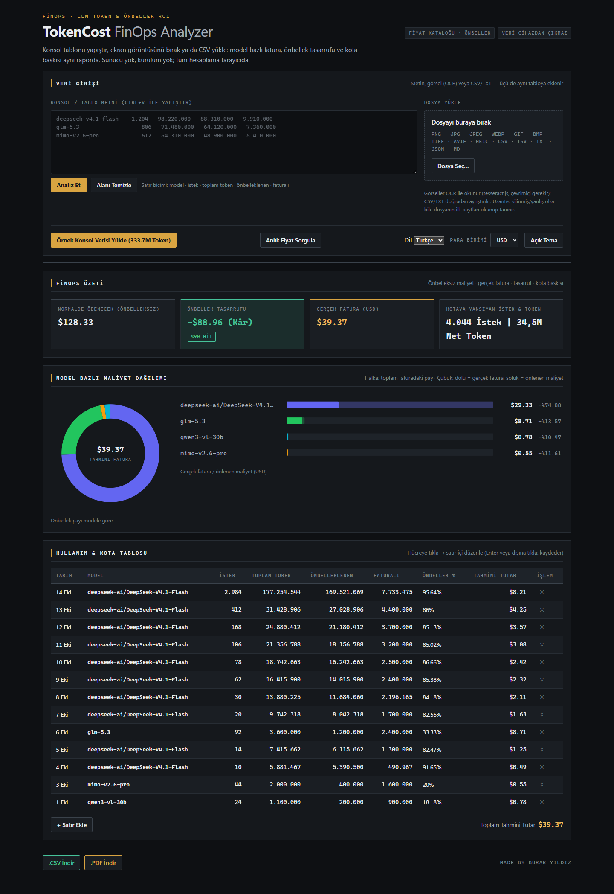

# TokenCost FinOps Analyzer

**LLM Kota ve Prompt Cache ROI Analiz Aracı** — %100 tarayıcıda çalışan, sunucusuz (zero-backend) FinOps hesaplayıcı.
Ekran görüntüsünü, kopyaladığınız konsol tablosunu veya CSV dosyasını verin; önbellek tasarrufunu,
gerçek faturayı ve kota dağılımını saniyeler içinde görün. **Hiçbir veri cihazınızdan çıkmaz.**

**Canlı demo:** https://burakyildizgamedev.github.io/tokencost-web/



> Made by Burak Yıldız

---

## Vitrin Senaryosu (örnek veriyle deneyin)

"Örnek Konsol Verisi Yükle (333.7M Token)" butonuna basın: 3 ekran görüntüsündeki 13 satır
(4 model: `deepseek-v4.1-flash`, `glm-5.3`, `mimo-v2.6-pro`, `qwen3-vl-30b`) anında tabloya yüklenir.

| Metrik | Değer |
| --- | --- |
| Toplam token | **333.698.885** (333,7M) |
| Toplam istek | **4.044** |
| Önbellek isabeti | **%89,66** |
| Gerçek fatura (tahmini) | **$13.80** |
| Önbellek olmasaydı | **$51.76** |
| Önbellek tasarrufu | **$37.96** (Kâr, %73,34) |

> Bu tablo uygulamadaki yerleşik (çevrimdışı) fiyat kataloğuyla hesaplanmıştır. Canlı sitede fiyatlar
> LiteLLM/OpenRouter'dan anlık çekildiği için tutarlar (ekran görüntüsündeki gibi) farklı çıkabilir.

## Özellikler

- **Çoklu girdi:** Ctrl+V ile tablo metni yapıştırma, ekran görüntüsü sürükle-bırak (OCR, Tesseract.js),
  CSV/TXT dosyası bırakma.
- **Akıllı ayrıştırma:** Türkçe konsol tablosu başlıkları (Zaman / Model / İstek / Toplam Token /
  Önbelleklenen / Kotaya Yansıyan), özet satırı ayıklama, mükerrer satır tekilleştirme
  (kaydırmalı ekran görüntülerindeki örtüşmeler çifte sayılmaz), OCR gürültüsü düzeltme (`O → 0`, `gIm → glm`).
- **FinOps motoru:** önbellek isabet oranı, normalde ödenecek tutar, önbellek tasarrufu (Kâr),
  net kota tokeni, model bazlı gruplama — hepsi `src/core` içinde saf (pure) fonksiyonlar.
- **Beş dilde arayüz (Faz 49):** Türkçe (varsayılan), İngilizce, Almanca, Çince ve İspanyolca.
  Seçim cihazda saklanır (`tokencost_language`), `<html lang>` güncellenir; kartlar, tablo başlıkları,
  grafik etiketleri ve bildirimler anında çevrilir.
- **Para birimi göstergesi:** USD (varsayılan), TRY ve EUR. USD'de tek tutar; TRY/EUR'de
  `$13.80 / ₺503,70` biçiminde ikili gösterim — kartlar, grafikler ve `.csv`/`.pdf` raporları senkron kalır.
- **Anlık fiyat sorgusu:** "Anlık Fiyat Sorgula" düğmesi yerel önbelleği atlar ve LiteLLM/OpenRouter
  kaynaklarından fiyatları yeniden çeker; ağ yoksa mevcut katalog korunur ve bilgi bildirimi gösterilir.
- **Esnek dosya kabulü (Faz 49):** PNG · JPG · JPEG · WEBP · GIF · BMP · TIFF · AVIF · HEIC ·
  CSV · TSV · TXT · JSON · MD. Uzantı yanlış/eksik olsa bile **ilk baytlara (magic bytes)** bakılır:
  içeriği PNG olan `gorunuste-metin.txt` görsel sayılır, MIME uyduran metin ise reddedilmez.
- **Fiyat kataloğu:** önbellek → LiteLLM → OpenRouter → çevrimdışı statik katalog zinciri;
  model adı normalizasyonu, takma ad (alias) ve bulanık eşleşme sayesinde `deepseek-ai/DeepSeek-V4.1-Flash`
  gibi sağlayıcı önekli adlar da doğru fiyatlanır. Hücreden birim fiyat düzenlenebilir.
- **Raporlama:** UTF-8 BOM'lu `.csv` (Excel uyumlu), yazdırılabilir `.pdf` raporu, GitHub Issue/PR için
  Markdown raporu ve panoya kopyalama; hepsinin altında `Made by Burak Yıldız` imzası.
- **Paylaşım:** `#data=...` URL hash'i ile sunucu olmadan analiz paylaşımı.
- **Tema:** Dark/Light tema (cihazda `tokencost_theme` anahtarında saklanır).
- **Bağımlılık yok:** çalışma zamanında hiçbir npm paketi, framework veya grafik kütüphanesi yok
  (grafikler saf SVG, tablo/state saf JavaScript).

## Desteklenen Dosya Biçimleri

| Tür | Biçimler | Akış |
| --- | --- | --- |
| Görsel (OCR) | PNG · JPG/JPEG · JFIF · WEBP · GIF · BMP · TIF/TIFF · AVIF · HEIC/HEIF | Tesseract.js (CDN, çevrimiçi gerekir) |
| Tablo/metin | CSV · TSV · TXT · LOG · JSON · MD | Doğrudan ayrıştırıcı (`src/core/parser.js`) |

Karar sırası: **MIME → magic bytes → uzantı**. İlk baytlar tanınırsa uzantı ve MIME yok sayılır
(`src/core/file-type.js`), böylece ismi `blob`, `image` veya `indir.txt` olan dosyalar da doğru hatta gider.
Hiçbiri tutmazsa `Desteklenmeyen dosya biçimi (…)` uyarısı gösterilir; içerik okunamazsa
`Dosya içeriği okunamadı…` mesajı verilir ve uygulama çökmez.

## Dil ve Para Birimi

| Ayar | Değerler | Varsayılan | Saklandığı yer |
| --- | --- | --- | --- |
| Arayüz dili | `tr` · `en` · `de` · `zh` · `es` | `tr` (Türkçe) | `localStorage["tokencost_language"]` |
| Para birimi | `USD` · `TRY` · `EUR` | `USD` | uygulama durumu (oturum) |

Dil seçildiğinde sözlük, `<html lang>` (`zh → zh-CN`), statik DOM etiketleri (index.html `data-i18n*`)
ve tablo/kart/grafik metinleri birlikte güncellenir; grafiklerde SVG içi `aria-label`, başlık, tooltip
ve boş durum metni de sözlükten gelir. Kullanıcıya tek bir bilgi bildirimi gösterilir.
Sözlük `src/core/i18n.js` içinde saf veri olarak durur; desteklenen beş dilde de **aynı anahtar kümesi**
bulunur (eksik çeviri testte kırmızıya düşer). Bilinmeyen dil kodunda arayüz sessizce Türkçeye döner.

Para birimi seçili tutar, USD üzerinden hesaplanan faturaya uygulanır (`src/services/currency-service.js`,
varsayılan kurlar: TRY 34,00 / EUR 0,92). Kur bulunamazsa çökme yerine USD gösterimi korunur.

## Anlık Fiyat Sorgusu

"Anlık Fiyat Sorgula" düğmesi `pricing-service` katmanını `forceRefresh` ile çağırır:

1. Yerel önbellek atlanır, LiteLLM fiyat dosyası ve OpenRouter model listesi denenir.
2. Başarılıysa kaynak çipi (`Fiyat kataloğu · LiteLLM` vb.) ve tablodaki birim fiyatlar güncellenir.
3. Ağ yoksa/yanıt geçersizse **mevcut katalog korunur**, düğme tekrar kullanılabilir hâle gelir ve
   bilgi bildirimi gösterilir (durum bozulmaz).

## Hızlı Başlangıç

ES modülleri `file://` üzerinden yüklenemez; küçük bir statik sunucu yeterlidir:

```bash
# 1) Depoyu alın
git clone https://github.com/brakyildiz/tokencost-finops.git
cd tokencost-finops

# 2) Testleri çalıştırın (49 faz sözleşmesi)
npm ci
npm test

# 3) Geliştirme sunucusunu başlatın (sıfır bağımlılık, Node 18+)
npm start          # http://localhost:5173
```

`npm start`, `scripts/serve.mjs` içindeki bağımlılıksız statik sunucuyu çalıştırır (yalnızca Node
`node:` modülleri; çalışma zamanı paketi yok). Port doluysa sırayla sonraki boş port denenir ve
adres konsola yazılır; `PORT=8080 npm start` ile port seçilebilir. Alternatif olarak
`python -m http.server 8080` veya herhangi bir statik sunucu da kullanılabilir.

OCR (ekran görüntüsü) özelliği Tesseract.js CDN'inden gelir; erişim yoksa metin/CSV akışı sorunsuz çalışır
(görsel yüklendiğinde kibar bir uyarı gösterilir).

## Mimari

```
index.html            # Statik iskelet (erişilebilir, SEO meta etiketli)
styles.css            # Dark/Light tema + @media print PDF stilleri
src/
  main.js             # Tarayıcı giriş noktası (initApp)
  app.js              # Faz 44: orkestratör — tüm katmanları DOM'a bağlar
  core/               # SAF katman: DOM/window/localStorage/fetch YOK
    schema.js         #   token kaydı ve fiyat profili modelleri
    calculator.js     #   maliyet, tasarruf, özet ve gruplama motoru
    parser.js         #   konsol tablosu ayrıştırıcı + tekilleştirme imzası
    normalizer.js     #   model adı normalizasyonu, alias, bulanık eşleşme
    formatter.js      #   Türkçe sayı/para biçimlendirme
    i18n.js           #   Faz 49: beş dilli sözlük + saf çeviri/ayırıcı yardımcıları
    file-type.js      #   Faz 49: MIME/uzantı/magic bytes ile dosya türü tespiti
    demo-data.js      #   örnek (vitrin) veri seti + çevrimdışı fiyat kataloğu
  ocr/                # OCR hattı (Tesseract enjekte edilir, saf mantık test edilebilir)
  services/           # fiyat, kur, dışa aktarım (CSV/PDF/Markdown/hash) servisleri
  ui/                 # store (pub/sub), bileşenler, grafikler, girdi olayları
scripts/
  serve.mjs           # ARAÇ: npm start — bağımlılıksız statik geliştirme sunucusu
tests/                # Vitest: 17 dosya, 348 test (unit + entegrasyon + E2E)
```

**Katman kuralı:** `src/core` ve `src/ocr` içinde DOM'a dokunulmaz; DOM yalnızca enjekte edilen
`ownerDocument` / `environment` üzerinden kullanılır. Bu sayede tüm iş mantığı Node üzerinde
DOM olmadan test edilebilir.

## Testler

```bash
npm test           # tek seferlik (CI ile aynı komut)
npm run test:watch # geliştirme sırasında izleme
npm start          # statik geliştirme sunucusu (http://localhost:5173)
```

Her faz TDD ile ilerledi (önce kırmızı test, sonra uygulama). E2E testleri ham metinden **$13.80**
faturaya, `.csv`/`.pdf` çıktısındaki imzaya ve 3 parçalı OCR akışının tekilleştirmesine kadar
tüm zinciri doğrular. Faz 49 kapsamı ayrıca şunları test eder: diller arası anahtar eşitliği (`i18n.test.js`),
magic-byte tabanlı dosya tanıma (`file-type.test.js`), dil değişiminin tablo/kart/depo ile birlikte
uygulanması ve anlık fiyat düğmesinin başarı/başarısızlık yolları (`e2e.test.js`).
`serve.test.js` ise `npm start` sözleşmesini gerçek HTTP üzerinden doğrular: kök isteğinde
`index.html`, modül MIME tipi (`text/javascript`), 404/405, gövdesiz `HEAD`, kapalı önbellek ve
kök dizin dışına çıkan/bozuk kodlamalı yolların reddedilmesi.

## Bilinen Sınırlar

- OCR (ekran görüntüsü) Tesseract.js CDN'ine bağlıdır; çevrimdışıyken metin/CSV akışı çalışmaya devam eder.
- Kur değerleri statik varsayılanlardır (canlı kur servisi çağrılmaz); karmaşık senaryolar için
  birim fiyatlar tablodan düzenlenebilir.
- Çevrilen yüzey: konsol arayüzü (butonlar, bölüm başlıkları, kartlar, tablo başlıkları, bildirimler) ve
  grafik SVG içi metinler (aria etiketi, başlık, tooltip, boş durum). Dışa aktarılan `.csv`/`.pdf` rapor
  başlıkları ve OCR ilerleme metinleri şu an Türkçedir; rapor çevirisi sonraki fazın konusudur.
- Sayı/para biçimlendirmesi tek yerel ayarı kullanır (`1.234,56`); `groupSeparator`/`decimalSeparator`
  yardımcıları sözlükte hazır ama biçimlendiriciye (`src/core/formatter.js`) henüz bağlanmadı.
- Model adı çözülemediğinde kullanılan `Bilinmeyen Model` etiketi veri katmanında (`src/core`) sabittir;
  grafik içi yüzdeler dilden bağımsız olarak `%73` biçiminde yazılır.
- Anlık fiyat sorgusu ve OCR internet gerektirir; ikisi de başarısızlıkta sessizce son iyi duruma döner.

## GitHub Pages Dağıtımı

1. Depoyu GitHub'a gönderin (`main` dalı).
2. **Settings → Pages → Build and deployment → Source: GitHub Actions** seçin.
3. `.github/workflows/deploy.yml` her `push` işleminde `npm test` çalıştırır; tüm testler yeşilse
   statik site Pages'e yayınlanır. **Kırmızı test = yayın yok.**

Yayındaki adres: https://burakyildizgamedev.github.io/tokencost-web/

## Lisans

MIT — dilediğiniz gibi kullanabilirsiniz.

<sub>Made by Burak Yıldız</sub>
