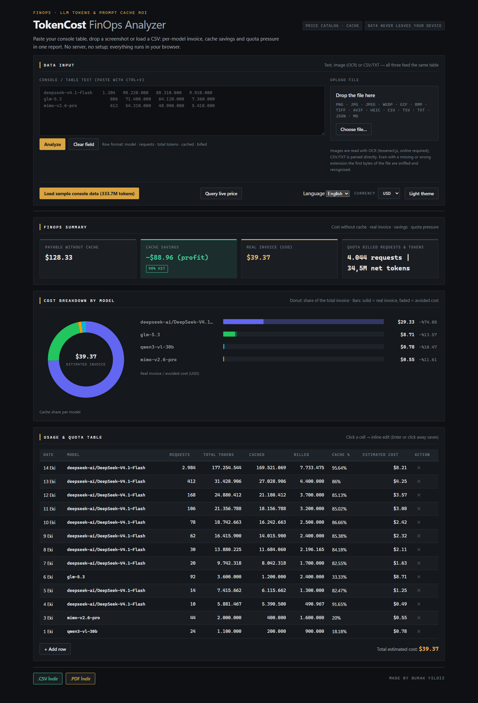

<div align="center">

# TokenCost FinOps Analyzer

**See what your LLM usage really costs — and how much prompt caching saves you.**

Paste a console usage table, drop a screenshot or load a CSV: get the real invoice, the cost you would
have paid without caching, and per-model quota pressure in seconds. Runs 100% in the browser —
**your data never leaves your device.**

[](https://github.com/BurakYildizGameDev/tokencost-web/actions/workflows/deploy.yml)
[](https://burakyildizgamedev.github.io/tokencost-web/)
[](LICENSE)


[**Live demo**](https://burakyildizgamedev.github.io/tokencost-web/) ·
[Features](#features) ·
[Getting started](#getting-started) ·
[How costs are calculated](#how-costs-are-calculated) ·
[Türkçe](README.tr.md)



</div>

## Why

LLM provider consoles show token counts, but rarely answer the questions that matter for the bill:

- How much of my traffic is served from the prompt cache, and what did that save?
- Which model drives the invoice?
- What would this month have cost without caching?

TokenCost answers these from whatever you already have — a copied table, a screenshot or an export file —
without sign-ups, API keys or a backend.

## Features

| | |
| --- | --- |
| **Three ways in** | Paste a table (Ctrl+V), drag & drop screenshots (OCR via Tesseract.js), or drop a CSV/TSV/TXT/JSON/MD file. |
| **Smart parsing** | Understands console table headers, strips summary rows, de-duplicates overlapping rows from scrolling screenshots and fixes common OCR noise (`O → 0`, `gIm → glm`). |
| **FinOps engine** | Cache hit rate, real invoice, cost without cache, cache savings and net quota tokens — overall and per model. |
| **Live pricing** | Prices come from LiteLLM → OpenRouter, cached locally for 24 h, with an offline catalog as a fallback. Provider-prefixed names such as `deepseek-ai/DeepSeek-V4.1-Flash` are resolved through normalisation, aliases and fuzzy matching. |
| **Editable** | Edit any cell inline (Enter saves, Escape cancels) or override unit prices per model. |
| **Reports** | Excel-friendly UTF-8 `.csv`, printable `.pdf`, Markdown report for GitHub issues/PRs, and shareable links (`#data=…`) — no server involved. |
| **5 languages, 3 currencies** | Turkish, English, German, Chinese, Spanish · USD, TRY, EUR. |
| **Robust file detection** | Files are identified by MIME, magic bytes and extension, so a PNG named `report.txt` still goes to OCR. |
| **Zero dependencies** | No framework, no chart library, no runtime npm packages. Charts are plain SVG, state is a ~50-line pub/sub store. |
| **Dark / light theme** | Remembered per device. |

### Supported inputs

| Type | Formats | Pipeline |
| --- | --- | --- |
| Image (OCR) | PNG · JPG/JPEG · JFIF · WEBP · GIF · BMP · TIFF · AVIF · HEIC/HEIF | Tesseract.js (loaded from CDN, needs internet) |
| Table / text | CSV · TSV · TXT · LOG · JSON · MD | Built-in parser (`src/core/parser.js`) |

## Getting started

Use it online: **https://burakyildizgamedev.github.io/tokencost-web/** — click **Load sample console data** to see a
13-row, 333.7M-token example.

Run it locally (Node 18+):

```bash
git clone https://github.com/BurakYildizGameDev/tokencost-web.git
cd tokencost-web
npm ci
npm start        # http://localhost:5173
```

`npm start` runs a dependency-free static server (`scripts/serve.mjs`). ES modules cannot be loaded over
`file://`, so opening `index.html` directly won't work — any static server (e.g. `python -m http.server`) is fine.
Use `PORT=8080 npm start` to pick a port; if the port is busy the next free one is used.

### Expected input

One row per model/day with these columns (Turkish and English headers are recognised; tab- or space-separated, `1,234` and `1.234` both work):

```
Date     Model                 Requests   Total tokens   Cached        Billed
14 Oct   deepseek-v4.1-flash   2,984      177,254,544    169,521,069   7,733,475
```

## How costs are calculated

All calculations live in pure functions in `src/core/calculator.js`. Prices are per **1M tokens**.

| Metric | Formula |
| --- | --- |
| Cache hit rate | `cached / total` (token-weighted, not an average of row percentages) |
| Real invoice | `cached × P_cache + billed × (α × P_in + (1 − α) × P_out)`, α = 0.3 input share |
| Cache savings | `cached × (P_in − P_cache)` |
| Cost without cache | `real invoice + cache savings` |

When a provider does not publish a cache-read price, 50% of the input price is assumed. When the same model is
listed by many providers, the canonical entry or a well-known provider is preferred over entries with
missing or zero prices.

> The live site uses live prices, so its totals differ from the offline catalog. With the built-in offline catalog
> the sample data comes to **$13.80** real invoice vs **$51.76** without cache (**$37.96** saved, 89.66% hit rate).

## Project structure

```
index.html              Static shell (accessible, SEO meta tags)
styles.css              Dark/light theme + print styles for PDF
src/
  main.js               Browser entry point
  app.js                Orchestrator: wires every layer to the DOM
  core/                 Pure logic — no DOM, window, localStorage or fetch
    calculator.js       Cost, savings, summary and grouping
    parser.js           Console table parser + de-duplication
    normalizer.js       Model name normalisation, aliases, fuzzy matching
    schema.js           Token record and pricing profile models
    i18n.js             Dictionaries for 5 languages
    file-type.js        MIME / magic bytes / extension detection
    formatter.js        Number and currency formatting
    demo-data.js        Sample dataset + offline price catalog
  ocr/                  OCR pipeline (Tesseract is injected; logic is testable)
  services/             Pricing, currency, export (CSV/PDF/Markdown/share link)
  ui/                   Store (pub/sub), table, cards, charts, input handling
scripts/serve.mjs       Zero-dependency dev server
tests/                  Vitest + jsdom: unit, integration and end-to-end
```

**Layering rule:** `src/core` and `src/ocr` never touch the DOM; the DOM is only reached through an injected
`document`/`environment`. That keeps all business logic testable in Node.

## Testing

```bash
npm test             # single run, same as CI
npm run test:watch   # watch mode
```

356 tests across 17 files cover the calculator, parser, OCR pipeline, pricing chain, i18n key parity,
file-type sniffing, exports, the dev server and full end-to-end flows in jsdom.

## Deployment

`.github/workflows/deploy.yml` runs the test suite on every push and pull request. On `main`, if all tests
pass, the static files (`index.html`, `styles.css`, `src/`) are published to GitHub Pages.
**A failing test blocks the deploy.**

To deploy your own fork, enable **Settings → Pages → Source: GitHub Actions**.

## Known limitations

- OCR and live pricing need an internet connection; without it, text/CSV input and the offline catalog keep working.
- Exchange rates are static defaults (TRY 34.00, EUR 0.92); unit prices can be edited in the table.
- Exported `.csv`/`.pdf` report headers, dates in the table and OCR progress messages are currently Turkish only.
- Number formatting always uses the `1.234,56` style regardless of language.

## Contributing

Issues and pull requests are welcome — see [CONTRIBUTING.md](CONTRIBUTING.md).

## License

[MIT](LICENSE) © Burak Yıldız
